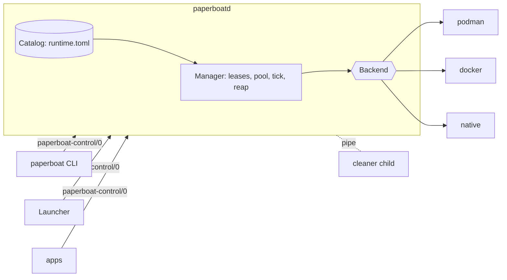

# Architecture

The design and the measurements behind it are in the RFC
(`plans/2026-11-24_15-00_container_first_platform.md` in the workspace; pb#438). This page is the map.

## 1. Overview

`paperboat` (CLI), the Launcher and every app are clients of one per-user daemon, `paperboatd`, over
`paperboat-control/0` (JSON lines on `$XDG_RUNTIME_DIR/paperboat/control.sock`). The daemon owns
every runtime instance: it reads the runtime manifests, picks a backend, starts instances under
**leases**, keeps station-mode instances warm between uses, notices instances that end on their own,
and makes sure none outlives it. No client talks to podman or docker.

## 2. Codemap

- `include/paperboat/manifest.hpp`, `src/lib/manifest.cpp`: `Manifest` (one runtime.toml),
  `parse_manifest`, version matching, `{placeholder}` expansion.
- `catalog.hpp`: `Catalog` (every manifest in the catalog folders; `resolve("julia@1.11")`).
- `policy.hpp`: `Policy`, the only way to weaken isolation; `weakened()` lists what it gives up.
- `backend.hpp`, `src/lib/backend_oci.cpp`, `backend_native.cpp`: `Backend` and its two
  implementations; `isolation_flags` (the defaults, in one place).
- `manager.hpp`, `src/lib/manager.cpp`: `Manager`, `Lease`, `AcquireRequest`: acquire/release,
  the warm pool, `tick` (idle expiry, ended instances), `reap`, `prune`, events.
- `control.hpp`, `src/lib/control.cpp`: `ControlClient` (starts the daemon on demand).
- `process.hpp`, `src/lib/process*.cpp`: `ProcessRunner`, from the Paperboat engine, unchanged.
- `src/daemon/main.cpp`: socket server, cleaner, signals, idle exit.
- `src/cli/main.cpp`: `paperboat runtimes …`, `paperboat daemon …`.

## 3. Invariants

1. **A runtime is data.** The daemon has no code per runtime; a runtime is added by a runtime.toml
   (tested: `a runtime added by file alone runs`).
2. **Container first, native as fallback.** Backend order `podman, docker, native` unless the request
   or `PAPERBOAT_BACKENDS` says otherwise.
3. **Pinned or refused.** A container backend runs `ref@digest`; an unpinned manifest is refused unless
   the request allows it.
4. **Strictest by default.** `--network=none`, read-only root, tmpfs `/tmp`, `--cap-drop=all`,
   `no-new-privileges`, pid/memory/cpu limits, project read-only, rootless user mapping. Only a
   `Policy` weakens it, and each weakening is an event (`policy.weakened`).
5. **SELinux:** the daemon's own folders (lease, deps, work) are relabelled `:Z`; a user's project is
   never relabelled, so mounting one turns labelling off for that container (`label=disable`).
6. **No orphans.** Instances carry `paperboat.daemon=<boot id>:<pid>`. A forked cleaner removes them
   when the daemon ends in any way; a new daemon reaps instances whose daemon is gone; a client that
   disconnects releases its leases. Each is tested against podman.
7. **Warm means a running process.** Station-mode instances stay running for the idle timeout and are
   reused by key (runtime, mode, backend, project, policy); session and exec instances are never shared.
8. **Clients only speak the protocol.** The CLI's `--json` output is the daemon's objects.
