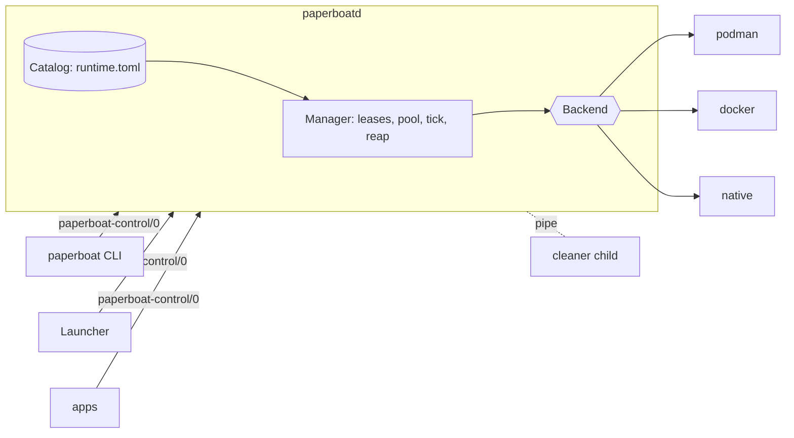

# Architecture

The design and the measurements behind it are in the RFC
(`plans/2026-11-24_15-00_container_first_platform.md` in the workspace; pb#438). This page is the map.

## 1. Overview

`paperboat` (CLI), the Launcher and every app are clients of one per-user daemon, `paperboatd`, over
`paperboat-control/0` (JSON lines on `$XDG_RUNTIME_DIR/paperboat/control.sock`). The daemon owns
every runtime instance: it reads the runtime manifests, picks a backend, starts instances under
**leases**, keeps station-mode instances warm between uses, notices instances that end on their own,
and makes sure none outlives it. No client talks to podman or docker.

## 2. Codemap

- `include/paperboat/manifest.hpp`, `src/lib/manifest.cpp`: `Manifest` (one runtime.toml),
  `parse_manifest`, version matching, `{placeholder}` expansion.
- `catalog.hpp`: `Catalog` (every manifest in the catalog folders; `resolve("julia@1.11")`).
- `policy.hpp`: `Policy`, the only way to weaken isolation; `weakened()` lists what it gives up.
- `backend.hpp`, `src/lib/backend_oci.cpp`, `backend_native.cpp`: `Backend` and its two
  implementations; `isolation_flags` (the defaults, in one place).
- `manager.hpp`, `src/lib/manager.cpp`: `Manager`, `Lease`, `AcquireRequest`: acquire/release,
  the warm pool, `tick` (idle expiry, ended instances), `reap`, `prune`, events.
- `control.hpp`, `src/lib/control.cpp`: `ControlClient` (starts the daemon on demand).
- `process.hpp`, `src/lib/process*.cpp`: `ProcessRunner`, from the Paperboat engine (plus a clean signal state for children).
- `runtime.hpp`, `src/lib/runtime_client.cpp`: `RuntimeClient`, the app side of
  `paperboat-runtime/0` (docs/runtime.md): JSON frames over `<ipc>/runtime.sock`, `interrupt`, and the
  shared-memory fast path (`open_fast`, `bind`, `call_fast`).
- `runtimes/<name>/runtime.toml` + `runtimes/<name>/lib/`: a runtime and its library. The library
  (Julia `PaperboatRuntime.jl`, Python `paperboat_runtime`, both stdlib only) is copied by the daemon to
  `<state>/lib/<runtime>` and mounted read-only at `/opt/pb`, so the upstream image works unchanged
  and a library fix needs no image rebuild.
- `images/`: one `Containerfile` for every runtime image (upstream base pinned by digest, library baked
  in, OCI labels) and `images.toml`; `.github/workflows/runtime-image.yml` (reusable) builds, scans
  (Trivy), attests (SBOM, SLSA provenance), signs (cosign keyless) and pushes from `main` only.
- `src/daemon/main.cpp`: socket server, cleaner, signals, idle exit.
- `src/cli/commands.toml`: the platform's command registry (every command's words, usage, group,
  alias), embedded into the CLI at build time; the Launcher and TUI read the same file. An installed
  app adds its own (`<home>/apps/<app>/commands.toml` plus `cli`, the program that runs them with every
  word as typed); `apps.toml` lists the words each app adds, so `paperboat run` before Simplicial is
  installed says which app to install. The platform's code names no app.
- `src/cli/main.cpp`: dispatch over the registry (longest match on names and aliases) and one handler
  per command.
- `src/lib/posix.hpp`: the calls that differ between Linux and macOS (cloexec sockets and pipes,
  SIGPIPE). The shm fast path stays Linux-only (futex).
- Packaging (CMakeLists `install`/CPack, `.github/workflows/package.yml`): components `cli` and
  `devel`; rpm `paperboat-cli` Requires `paperboat-devel`; macOS one `.pkg` with both. The Launcher's
  package will Require `paperboat-cli`.
- `apps.toml`, `toolkits.toml`: the app and toolkit registries (no apps yet; the five
  `simplicial-toolkit-*` repos), installed to `share/paperboat/`.

## 3. Invariants

1. **A runtime is data.** The daemon has no code per runtime; a runtime is added by a runtime.toml
   (tested: `a runtime added by file alone runs`).
2. **Container first, native as fallback.** Backend order `podman, docker, native` unless the request
   or `PAPERBOAT_BACKENDS` says otherwise.
3. **Pulled when needed.** A runtime whose image is missing is pulled on first acquire (tested:
   `a runtime's image is pulled automatically the first time it is needed`).
4. **Pinned or refused.** A container backend runs `ref@digest`; an unpinned manifest is refused unless
   the request allows it.
5. **Strictest by default.** `--network=none`, read-only root, tmpfs `/tmp`, `--cap-drop=all`,
   `no-new-privileges`, pid/memory/cpu limits, project read-only, rootless user mapping. Only a
   `Policy` weakens it, and each weakening is an event (`policy.weakened`).
6. **SELinux:** the daemon's own folders (lease, deps, work) are relabelled `:Z`; a user's project is
   never relabelled, so mounting one turns labelling off for that container (`label=disable`).
7. **No orphans.** Instances carry `paperboat.daemon=<boot id>:<pid>`. A forked cleaner removes them
   when the daemon ends in any way; a new daemon reaps instances whose daemon is gone; a client that
   disconnects releases its leases. Each is tested against podman.
8. **Warm means a running process.** Station-mode instances stay running for the idle timeout and are
   reused by key (runtime, mode, backend, project, policy); session and exec instances are never shared.
9. **Clients only speak the protocols.** The CLI's `--json` output is the daemon's objects; an app
   talks to a runtime only through `paperboat-runtime/0`.
10. **Data never crosses stdio.** Podman relays a container's stdio through conmon (+30–130 µs a call);
   the runtime listens on a socket in the lease's ipc folder, and hot calls use shared memory there.
11. **Scanned before it ships.** A runtime image's base is scanned (Trivy) and a fixable CRITICAL
    issue fails the build. The fix is a newer pinned base (`images/images.toml` and the runtime's
    `runtime.toml`, same digest); an issue that can't reach the image is ignored in
    `images/trivy/ignore.rego` with its reason, never silenced in the workflow.
12. **Signed means verified.** A manifest that names `image.signer` runs only after `cosign verify` of
    its digest succeeds (once per digest per daemon), unless the request allows it; the lease's
    `verified` says which (`signature`, `unsigned`, `skipped`, `native`) for the run record.
13. **Children inherit nothing odd.** `ProcessRunner` clears the signal mask and ignored signals before
    exec: the daemon blocks SIGINT for its signal thread, and a runtime must still be interruptible.
